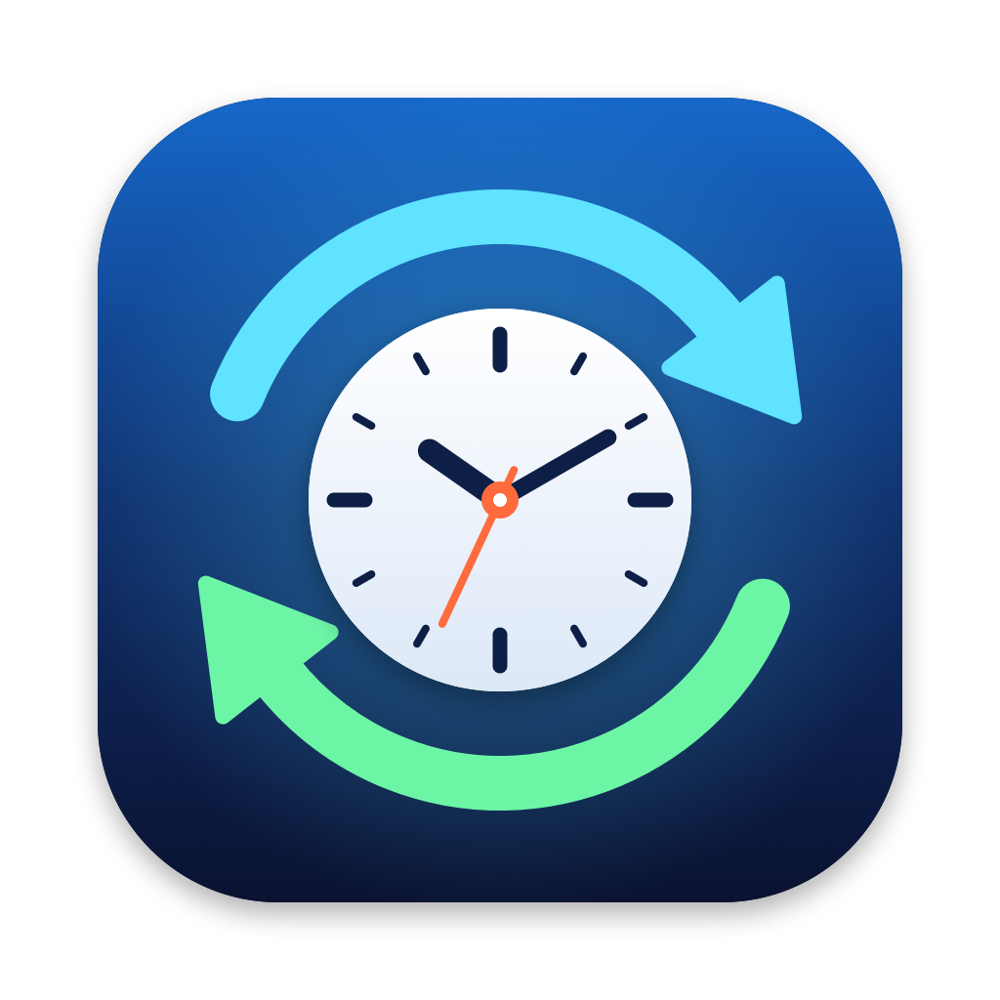

<p align="center">
  
</p>

# NTP Checker

โปรแกรมสำหรับตรวจสอบความแม่นยำของ NTP server โดยเทียบเวลาของ **เซิร์ฟเวอร์เป้าหมาย** กับ **เซิร์ฟเวอร์อ้างอิง** (ค่าเริ่มต้น `time.google.com`) แล้วตัดสิน PASS / FAIL ตามค่า threshold ที่กำหนด

ใน repo นี้มี 2 เวอร์ชัน:

| เวอร์ชัน | ไฟล์ | เทคโนโลยี | แพลตฟอร์ม |
|---|---|---|---|
| **2.0** (หลัก) | `NTPTester/` + `build.sh` | Swift / SwiftUI แอป macOS แบบ native | macOS 27 ขึ้นไป, Apple Silicon (arm64) |
| 1.x (เดิม) | `NTP_TEST.py` | Python + customtkinter | ทุกระบบที่รัน Python 3 ได้ |

## ความสามารถ

- คิวรี NTP (UDP/123) ไปยังเซิร์ฟเวอร์เป้าหมายและเซิร์ฟเวอร์อ้างอิง **พร้อมกัน**
- คำนวณ offset และ round-trip delay จาก timestamp ทั้ง 4 ค่า (t1–t4) ตาม RFC 5905
- เก็บหลายตัวอย่างต่อครั้ง แล้วใช้ค่า **median** ของ offset / delay
- แสดงค่า **Δ** (offset เป้าหมาย − offset อ้างอิง) หน่วย ms พร้อมผล PASS / FAIL เทียบ threshold
- แสดงรายละเอียดของแต่ละเซิร์ฟเวอร์: IP, stratum, leap, poll, precision, root delay, root dispersion, reference ID, เวลาของเซิร์ฟเวอร์
- เลือก NTP version 3 หรือ 4 และ address family แบบ Auto / IPv4 / IPv6
- โหมดเช็คอัตโนมัติตามช่วงเวลาที่กำหนด (2–3600 วินาที)
- Log ในโปรแกรม (คัดลอก / ล้างได้) และ **Export CSV**
- จำค่าที่ตั้งไว้ระหว่างการเปิดโปรแกรม (เวอร์ชัน 2.0)

การตรวจสอบคำตอบในเวอร์ชัน 2.0:

- ใส่ค่าสุ่ม (nonce) ใน transmit timestamp และยอมรับเฉพาะคำตอบที่สะท้อนค่านั้นกลับมา
- ปฏิเสธคำตอบ Kiss-o'-Death (stratum 0), stratum > 15, leap = 3 (ยังไม่ซิงค์) และ timestamp ที่เป็นศูนย์
- เว้นระยะระหว่างตัวอย่าง 0.5 วินาที เพื่อลดโอกาสโดน rate-limit

## NTP Checker 2.0 (macOS)

### สิ่งที่ต้องมี

- macOS 27 ขึ้นไป บนเครื่อง Apple Silicon
- Xcode Command Line Tools (`swiftc`, `iconutil`, `sips`, `codesign`) — ติดตั้งด้วย `xcode-select --install`

ไม่ต้องใช้ Xcode project หรือ dependency ภายนอก

### Build

```zsh
./build.sh
```

สคริปต์จะคอมไพล์ซอร์สใน `NTPTester/Sources/` สร้างไอคอนจาก `NTPTester/make_icon.swift` ประกอบเป็น `NTP Checker.app` ไว้ที่โฟลเดอร์ราก แล้วเซ็นแบบ ad-hoc

> ตัว `.app` เป็นผลลัพธ์จากการ build จึงไม่ถูกเก็บใน git (ดู `.gitignore`)

### รัน

```zsh
open "NTP Checker.app"
```

แอปเซ็นแบบ ad-hoc เท่านั้น หากคัดลอกไปเครื่องอื่น Gatekeeper อาจบล็อก ให้ build บนเครื่องนั้นเอง หรือคลิกขวาที่แอปแล้วเลือก Open

### คีย์ลัด

| คีย์ | การทำงาน |
|---|---|
| `⌘R` | เช็คทันที |
| `⌘E` | Export CSV |

### ค่าที่ตั้งได้

| ค่า | ค่าเริ่มต้น | ช่วงที่ใช้ได้ |
|---|---|---|
| เซิร์ฟเวอร์เป้าหมาย | `pool.ntp.org` | ชื่อโฮสต์หรือ IP |
| เซิร์ฟเวอร์อ้างอิง | `time.google.com` | ชื่อโฮสต์หรือ IP |
| NTP version | 4 | 3 หรือ 4 |
| Address family | Auto | Auto / IPv4 / IPv6 |
| Timeout | 2.5 วินาที | 0.2–30 วินาที |
| จำนวนตัวอย่าง | 3 | 1–20 |
| Threshold | 100 ms | ตั้งแต่ 0 ขึ้นไป |
| ช่วงเวลาเช็คอัตโนมัติ | 5 วินาที | 2–3600 วินาที |

## เวอร์ชัน Python (เดิม)

```zsh
pip install customtkinter
python3 NTP_TEST.py
```

ต้องใช้ Python 3 ที่มี `tkinter` ส่วนไลบรารีอื่นเป็น standard library ทั้งหมด

## โครงสร้างโปรเจกต์

```
.
├── build.sh                  # สคริปต์ build แอป macOS
├── NTPTester/
│   ├── Sources/
│   │   ├── App.swift         # UI (SwiftUI), model, log, Export CSV
│   │   └── NTPClient.swift   # NTP client (BSD socket) และการคำนวณ offset / delay
│   ├── make_icon.swift       # สร้างไอคอนแอป 1024×1024
│   └── logo_1024.png         # โลโก้
└── NTP_TEST.py               # เวอร์ชัน Python + customtkinter
```

## การอ่านผล

- **offset** — เวลาของเซิร์ฟเวอร์ลบเวลาของเครื่องนี้ ค่าบวกแปลว่าเซิร์ฟเวอร์เร็วกว่าเครื่องนี้
- **delay** — เวลาเดินทางไป-กลับของแพ็กเก็ต ไม่รวมเวลาประมวลผลของเซิร์ฟเวอร์
- **Δ** — offset ของเป้าหมายลบ offset ของอ้างอิง เนื่องจากทั้งสองค่าวัดเทียบกับนาฬิกาเครื่องเดียวกัน ความคลาดเคลื่อนของนาฬิกาเครื่องนี้จึงหักล้างกัน
- **PASS** เมื่อ |Δ| ≤ threshold

## หมายเหตุด้านเครือข่าย

- ต้องออก UDP พอร์ต 123 ไปยังทั้งสองเซิร์ฟเวอร์ได้
- เมื่อเช็คเซิร์ฟเวอร์ในเครือข่ายภายใน macOS อาจถามสิทธิ์ Local Network ในครั้งแรก
- เซิร์ฟเวอร์สาธารณะบางแห่งจำกัดความถี่ของคำขอ หากได้ Kiss-o'-Death `RATE` ให้ลดจำนวนตัวอย่างหรือเพิ่มช่วงเวลาเช็คอัตโนมัติ
